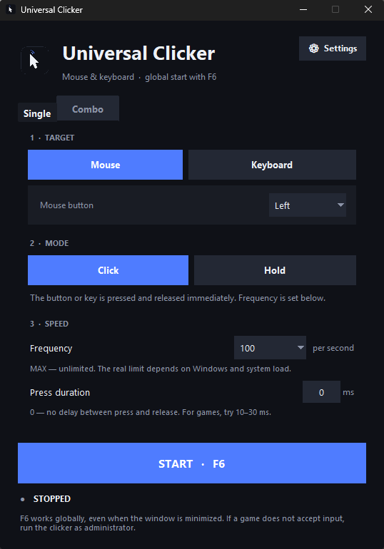
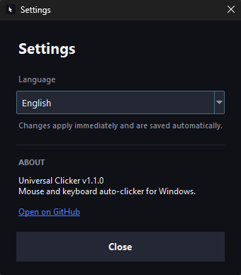

# Универсальный кликер

Автокликер для мыши и клавиатуры под Windows. Две вкладки: **«Одиночный»** и **«Комбо»**. Управляется глобальной клавишей **F6** — окно может быть свёрнуто. Интерфейс на английском и русском; при первом запуске — English.

| «Одиночный» | «Комбо» |
|:---:|:---:|
|  |  |

## Язык интерфейса

При первом запуске интерфейс открывается на английском. Язык переключается кнопкой **⚙ Настройки** и сохраняется между запусками.

## Скачать

Готовый `UniversalClicker.exe` лежит в разделе [Releases](https://github.com/glor2w/universal-clicker/releases/latest). Отдельная установка не нужна — запустите файл.

## Возможности

- **Вкладка «Одиночный»**: одна цель — мышь или клавиатура.
- **Вкладка «Комбо»**: мышь и клавиатура работают одновременно и независимо.
  - У каждого канала свой режим, частота и удержание.
  - Например, можно зажать мышь и одновременно кликать клавишей.
- **Мышь**: левая, правая или средняя кнопка.
- **Клавиатура**: любая клавиша (захват нажатием).
- **Режим «Клик»** — кнопка/клавиша нажимается с заданной частотой.
- **Режим «Зажатие»** — кнопка/клавиша удерживается до повторного F6.
- Частота от 1 до 1 000 000 в секунду, пресет **МАКС** (без ограничения).
- Настраиваемое удержание нажатия в миллисекундах (для игр).
- Живой счётчик фактической скорости.
- Глобальный старт/стоп по **F6**, защита от «залипания» клавиши при остановке.
- Во время работы активная вкладка остаётся доступной, переключение на другую блокируется.
- Английский и русский интерфейс, настройки языка сохраняются автоматически.

## Запуск

1. `UniversalClicker.exe` — готовое приложение из [Releases](https://github.com/glor2w/universal-clicker/releases/latest).
2. Или `run.bat`.
3. Или вручную: `python main.py` (нужен Python 3.10+ с Tkinter).

## Сборка

Запустите `build.bat` — он соберёт `UniversalClicker.exe` через PyInstaller вместе с иконкой. Требуется `pip install pyinstaller`.

## Как пользоваться

1. Откройте нужную вкладку: **«Одиночный»** или **«Комбо»**.
2. **«Одиночный»**:
   - Выберите цель: **Мышь** или **Клавиатура**.
   - Для клавиатуры нажмите кнопку с названием клавиши и нажмите нужную клавишу.
   - Выберите режим: **Клик** или **Зажатие**.
3. **«Комбо»**: настройте мышь и клавиатуру отдельно.
   - Для каждого канала выберите **Клик** или **Зажатие**.
   - Для клавиатуры нажмите кнопку с названием клавиши и нажмите нужную клавишу.
4. Задайте частоту. **МАКС** — максимальная скорость без ограничения.
   - Для игр начните со 100–1000 в секунду и удержания 10–30 мс.
5. Нажмите **Старт** или **F6**. Повторное F6 — стоп для обоих каналов.
6. Язык меняется в **⚙ Настройки**; выбор сохраняется автоматически.

## Про скорость

- На этой машине режим **МАКС** отправляет примерно **20 000 кликов/с** (пакетная отправка через Windows `SendInput`).
- Реальные 100 000 кликов/с через стандартный Windows API недостижимы: систему ограничивает очередь ввода. Программа показывает фактическую скорость, а не «теоретическую».
- На вкладке **«Комбо»** счётчик показывает суммарную скорость обоих каналов.
- Многие игры и приложения не успевают обрабатывать такие частоты, поэтому для них используйте 100–1000 кликов/с и удержание 10–30 мс.
- Чем выше частота, тем больше нагрузка на CPU.

## Важно

- **F6** и клавиши **Win** зарезервированы и не могут быть целью.
- Если приложение/игра запущены от администратора, кликер тоже нужно запустить от администратора — иначе Windows заблокирует ввод.
- Некоторые антивирусы могут реагировать на автокликеры и PyInstaller-сборки.
- Не используйте там, где автоматизация запрещена правилами.

## Файлы

- `main.py` — исходник (без внешних зависимостей, только стандартная библиотека).
- `assets/` — иконка приложения.
- `screenshots/` — скриншоты для README.
- `run.bat` — запуск.
- `build.bat` — пересборка exe через PyInstaller (`pip install pyinstaller`).
- `UniversalClicker.exe` — готовое приложение в [Releases](https://github.com/glor2w/universal-clicker/releases/latest), в репозиторий не входит.
- `%APPDATA%\UniversalClicker\settings.json` — сохранённый язык интерфейса.

## Лицензия

MIT — см. [LICENSE](LICENSE).
