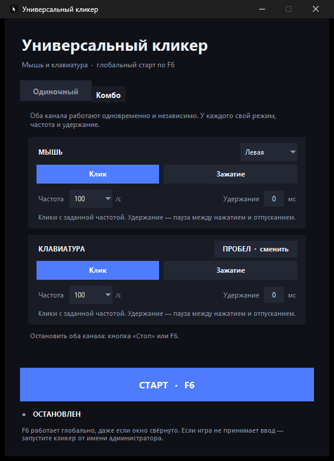

# Universal Clicker

Auto-clicker for mouse and keyboard on Windows. Two tabs: **Single** and **Combo**. Starts and stops with the global **F6** hotkey, even when the window is minimized.

The interface is available in English and Russian. English is used on first launch.

| Single | Combo |
|:---:|:---:|
|  |  |

## Settings and language

Open **⚙ Settings** to switch the language. The choice is applied immediately and saved to `%APPDATA%\UniversalClicker\settings.json`.

## Download

The ready-to-use `UniversalClicker.exe` is available on the [Releases](https://github.com/glor2w/universal-clicker/releases/latest) page. No installation is required — just run the file.

## Features

- **Single tab**: one target — mouse or keyboard.
- **Combo tab**: mouse and keyboard run at the same time and independently.
  - Each channel has its own mode, frequency and press duration.
  - For example, you can hold the mouse button while clicking a key.
- **Mouse**: left, right or middle button.
- **Keyboard**: any key (captured by pressing it).
- **Click mode** — the button or key is pressed at the selected frequency.
- **Hold mode** — the button or key is held until F6 is pressed again or Stop is clicked.
- Frequency from 1 to 1,000,000 per second, with a **MAX** preset (unlimited).
- Adjustable press duration in milliseconds (useful for games).
- Live actual-rate counter.
- Global **F6** start/stop with stuck-key protection.
- The active tab stays available while running; switching to the other tab is locked.
- English and Russian UI; the selected language is saved automatically.

## Run

1. `UniversalClicker.exe` — the ready-to-use app from [Releases](https://github.com/glor2w/universal-clicker/releases/latest).
2. Or `run.bat`.
3. Or manually: `python main.py` (Python 3.10+ with Tkinter).

## Build

Run `build.bat` to build `UniversalClicker.exe` with PyInstaller, including the icon and assets. Requires `pip install pyinstaller`.

## Usage

1. Open the **Single** or **Combo** tab.
2. **Single**:
   - Choose the target: **Mouse** or **Keyboard**.
   - For the keyboard, click the key button and press the desired key.
   - Choose the mode: **Click** or **Hold**.
3. **Combo**: configure mouse and keyboard separately.
   - Choose **Click** or **Hold** for each channel.
   - For the keyboard, click the key button and press the desired key.
4. Set the frequency. **MAX** means unlimited speed.
   - For games, start with 100–1000 per second and a press duration of 10–30 ms.
5. Click **Start** or press **F6**. Press F6 again to stop both channels.
6. Change the language in **⚙ Settings**; the choice is saved automatically.

## About speed

- On this machine, **MAX** mode sends about **20,000 clicks/s** (batched input through Windows `SendInput`).
- A true 100,000 clicks/s through the standard Windows API is not achievable: the input queue limits the system. The app shows the actual rate, not a theoretical one.
- In **Combo** mode, the counter shows the combined rate of both channels.
- Many games and applications cannot keep up with such rates, so use 100–1000 clicks/s and a 10–30 ms press duration for them.
- Higher frequencies put more load on the CPU.

## Important

- **F6** and the **Win** keys are reserved and cannot be used as targets.
- If the game or application runs as administrator, run the clicker as administrator too — otherwise Windows will block the input.
- Some antivirus products may react to auto-clickers and PyInstaller builds.
- Do not use the app where automation is prohibited by the rules.

## Files

- `main.py` — source code (standard library only, no external dependencies).
- `assets/` — application icon and header logo.
- `screenshots/` — README screenshots.
- `run.bat` — launch script.
- `build.bat` — rebuild the exe with PyInstaller (`pip install pyinstaller`).
- `UniversalClicker.exe` — the ready-to-use app on the [Releases](https://github.com/glor2w/universal-clicker/releases/latest) page; not tracked in the repository.
- `%APPDATA%\UniversalClicker\settings.json` — saved interface language.

## License

MIT — see [LICENSE](LICENSE).

---

## Русский

Автокликер для мыши и клавиатуры под Windows. Две вкладки: **Single** и **Combo**. Запуск и остановка глобальной клавишей **F6** — окно может быть свёрнуто.

Интерфейс доступен на английском и русском. При первом запуске используется английский. Язык переключается в **⚙ Settings** и сохраняется в `%APPDATA%\UniversalClicker\settings.json`.

### Возможности

- **Вкладка Single**: одна цель — мышь или клавиатура.
- **Вкладка Combo**: мышь и клавиатура работают одновременно и независимо.
  - У каждого канала свой режим, частота и удержание нажатия.
  - Например, можно зажать кнопку мыши и одновременно кликать клавишей.
- **Мышь**: левая, правая или средняя кнопка.
- **Клавиатура**: любая клавиша (захват нажатием).
- **Режим Click** — кнопка или клавиша нажимается с заданной частотой.
- **Режим Hold** — кнопка или клавиша удерживается до повторного F6 или нажатия Stop.
- Частота от 1 до 1 000 000 в секунду, пресет **MAX** (без ограничения).
- Настраиваемое удержание нажатия в миллисекундах (полезно для игр).
- Живой счётчик фактической скорости.
- Глобальный старт/стоп по **F6** с защитой от «залипания» клавиши.
- Во время работы активная вкладка остаётся доступной, переключение на другую блокируется.
- Английский и русский интерфейс; выбранный язык сохраняется автоматически.

### Запуск

1. `UniversalClicker.exe` — готовое приложение из [Releases](https://github.com/glor2w/universal-clicker/releases/latest).
2. Или `run.bat`.
3. Или вручную: `python main.py` (нужен Python 3.10+ с Tkinter).

### Сборка

Запустите `build.bat` — он соберёт `UniversalClicker.exe` через PyInstaller вместе с иконкой и ассетами. Требуется `pip install pyinstaller`.

### Как пользоваться

1. Откройте вкладку **Single** или **Combo**.
2. **Single**:
   - Выберите цель: **Mouse** или **Keyboard**.
   - Для клавиатуры нажмите кнопку с названием клавиши и нажмите нужную клавишу.
   - Выберите режим: **Click** или **Hold**.
3. **Combo**: настройте мышь и клавиатуру отдельно.
   - Для каждого канала выберите **Click** или **Hold**.
   - Для клавиатуры нажмите кнопку с названием клавиши и нажмите нужную клавишу.
4. Задайте частоту. **MAX** — максимальная скорость без ограничения.
   - Для игр начните со 100–1000 в секунду и удержания 10–30 мс.
5. Нажмите **Start** или **F6**. Повторное F6 — стоп для обоих каналов.
6. Язык меняется в **⚙ Settings**; выбор сохраняется автоматически.

### Про скорость

- На этой машине режим **MAX** отправляет примерно **20 000 кликов/с** (пакетная отправка через Windows `SendInput`).
- Реальные 100 000 кликов/с через стандартный Windows API недостижимы: систему ограничивает очередь ввода. Программа показывает фактическую скорость, а не «теоретическую».
- На вкладке **Combo** счётчик показывает суммарную скорость обоих каналов.
- Многие игры и приложения не успевают обрабатывать такие частоты, поэтому для них используйте 100–1000 кликов/с и удержание 10–30 мс.
- Чем выше частота, тем больше нагрузка на CPU.

### Важно

- **F6** и клавиши **Win** зарезервированы и не могут быть целью.
- Если приложение или игра запущены от администратора, кликер тоже нужно запустить от администратора — иначе Windows заблокирует ввод.
- Некоторые антивирусы могут реагировать на автокликеры и PyInstaller-сборки.
- Не используйте там, где автоматизация запрещена правилами.

### Файлы

- `main.py` — исходник (только стандартная библиотека, без внешних зависимостей).
- `assets/` — иконка приложения и логотип в шапке.
- `screenshots/` — скриншоты для README.
- `run.bat` — запуск.
- `build.bat` — пересборка exe через PyInstaller (`pip install pyinstaller`).
- `UniversalClicker.exe` — готовое приложение в [Releases](https://github.com/glor2w/universal-clicker/releases/latest), в репозиторий не входит.
- `%APPDATA%\UniversalClicker\settings.json` — сохранённый язык интерфейса.

### Лицензия

MIT — см. [LICENSE](LICENSE).
